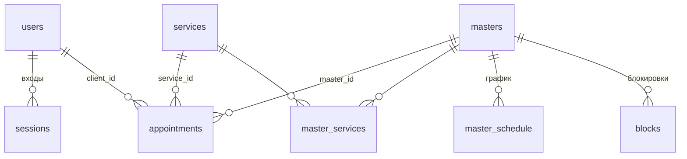

# Схема базы данных

SQLite через встроенный `node:sqlite` (Node.js 22). Файл базы — `DB_PATH`, по умолчанию `data/app.db` (в `.gitignore`).

Структура меняется только нумерованными миграциями `migrations/NNN_*.sql`. При старте сервера
`server/migrate.js` применяет новые миграции по порядку (каждую в транзакции) и записывает их
в `schema_migrations`. Затем `server/seed.js` заполняет пустые таблицы начальными данными.
Для каждого соединения включено `PRAGMA foreign_keys = ON`.

Актуальная схема: миграции `001_init.sql` и `002_login_attempts.sql`.

## Соглашения

- Время визита — текст по Москве `'YYYY-MM-DD HH:MM'`. Такие строки правильно сравниваются как текст.
- Служебные метки (`created_at`, `updated_at`, `expires_at`) — UTC, ISO-8601.
- Деньги — целые рубли, длительность — целые минуты.
- Флаги — `INTEGER` 0/1 с `CHECK`.
- День недели — `0` = вс … `6` = сб (как `Date#getDay` во фронтенде).
- Часы салона, шаг сетки 30 мин, окно записи 30 дней и правило 24 ч — константы в коде, не в БД.

## Связи

`design_option` — одна строка с настройками опции «Дизайн ногтей», без связей.
`login_attempts` — счётчик неудачных входов по email, без связей.

## Таблицы

### schema_migrations — применённые миграции
| Поле | Тип | Ограничения |
|---|---|---|
| version | TEXT | PK, имя файла (`001_init.sql`) |
| applied_at | TEXT | NOT NULL, UTC |

### users — клиенты и администратор
| Поле | Тип | Ограничения |
|---|---|---|
| id | INTEGER | PK |
| name | TEXT | NOT NULL |
| email | TEXT | NOT NULL, UNIQUE, COLLATE NOCASE; хранится в нижнем регистре |
| password_hash | TEXT | NOT NULL; `scrypt$<соль hex>$<хеш hex>` |
| role | TEXT | NOT NULL, DEFAULT `'client'`, CHECK `client`/`admin` |
| created_at | TEXT | NOT NULL |

### sessions — сессии входа

Токен — 32 случайных байта (base64url), выдаётся только в cookie `az_session`
(HttpOnly, SameSite=Lax, Path=/, срок 30 дней, Secure при https). В БД — только SHA-256 токена.
Срок фиксированный, не продлевается; выход удаляет строку; просроченные сессии
удаляются при каждом входе и регистрации.

| Поле | Тип | Ограничения |
|---|---|---|
| id | INTEGER | PK |
| user_id | INTEGER | NOT NULL → `users.id`, ON DELETE CASCADE |
| token_hash | TEXT | NOT NULL, UNIQUE; SHA-256 токена, сам токен не хранится |
| created_at | TEXT | NOT NULL |
| expires_at | TEXT | NOT NULL |

Индексы: `ix_sessions_user (user_id)`, `ix_sessions_expires (expires_at)`.

### login_attempts — неудачные попытки входа (002_login_attempts.sql)
| Поле | Тип | Ограничения |
|---|---|---|
| id | INTEGER | PK |
| email | TEXT | NOT NULL, COLLATE NOCASE; в нижнем регистре, в том числе несуществующий |
| attempted_at | TEXT | NOT NULL, UTC |

Индекс `ix_login_attempts_email_time (email, attempted_at)`. Не больше 10 неудачных попыток
за 15 минут на email — дальше `429 TOO_MANY_ATTEMPTS`. Успешный вход очищает записи этого email,
записи старше 15 минут удаляются при каждой новой неудаче. Связей с другими таблицами нет.

### services — услуги
| Поле | Тип | Ограничения |
|---|---|---|
| id | INTEGER | PK |
| name | TEXT | NOT NULL |
| duration_min | INTEGER | NOT NULL, > 0 |
| price | INTEGER | NOT NULL, ≥ 0 |
| is_nail | INTEGER | 0/1; к ногтевой услуге можно добавить дизайн |
| is_active | INTEGER | 0/1; отключение вместо удаления |

### design_option — настройки опции «Дизайн ногтей» (ровно одна строка)
| Поле | Тип | Ограничения |
|---|---|---|
| id | INTEGER | PK, CHECK `id = 1` |
| name | TEXT | NOT NULL, DEFAULT `'Дизайн ногтей'` |
| price_per_two_nails | INTEGER | NOT NULL, ≥ 0 (300 ₽) |
| extra_min_2_4 | INTEGER | NOT NULL, ≥ 0 (+15 мин за 2–4 ногтя) |
| extra_min_6_10 | INTEGER | NOT NULL, ≥ 0 (+30 мин за 6–10 ногтей) |

Возможное число ногтей (2, 4, 6, 8, 10) задано паспортом и проверяется в `appointments.design_nails`.

### masters — мастера
| Поле | Тип | Ограничения |
|---|---|---|
| id | INTEGER | PK |
| name | TEXT | NOT NULL |
| specialization | TEXT | NOT NULL |
| does_design | INTEGER | 0/1; выполняет ли «Дизайн ногтей» |
| is_active | INTEGER | 0/1; отключение вместо удаления |

### master_services — услуги мастера
| Поле | Тип | Ограничения |
|---|---|---|
| master_id | INTEGER | → `masters.id`, ON DELETE CASCADE |
| service_id | INTEGER | → `services.id`, ON DELETE CASCADE |

PK `(master_id, service_id)`; индекс `ix_master_services_service (service_id)`.

### master_schedule — график работы
| Поле | Тип | Ограничения |
|---|---|---|
| id | INTEGER | PK |
| master_id | INTEGER | NOT NULL → `masters.id`, ON DELETE CASCADE |
| weekday | INTEGER | 0–6 |
| start_time | TEXT | NOT NULL, `HH:MM` |
| end_time | TEXT | NOT NULL, `HH:MM` |

CHECK `start_time < end_time`; UNIQUE `(master_id, weekday)` — один интервал на день.

### blocks — еженедельные блокировки
| Поле | Тип | Ограничения |
|---|---|---|
| id | INTEGER | PK |
| master_id | INTEGER | NOT NULL → `masters.id`, ON DELETE CASCADE |
| weekday | INTEGER | 0–6 |
| all_day | INTEGER | 0/1 |
| start_time | TEXT | `HH:MM`; NULL при `all_day = 1` |
| end_time | TEXT | `HH:MM`; NULL при `all_day = 1` |
| reason | TEXT | NOT NULL, DEFAULT `''` |

CHECK: либо `all_day = 1` и время пустое, либо `all_day = 0` и `start_time < end_time`.
Индекс `ix_blocks_master_weekday (master_id, weekday)`.

### appointments — записи
| Поле | Тип | Ограничения |
|---|---|---|
| id | INTEGER | PK |
| client_id | INTEGER | NOT NULL → `users.id`, ON DELETE RESTRICT |
| master_id | INTEGER | NOT NULL → `masters.id`, ON DELETE RESTRICT |
| service_id | INTEGER | NOT NULL → `services.id`, ON DELETE RESTRICT |
| design_nails | INTEGER | NOT NULL, DEFAULT 0, CHECK IN (0, 2, 4, 6, 8, 10) |
| start_at | TEXT | NOT NULL, `YYYY-MM-DD HH:MM`, Москва |
| end_at | TEXT | NOT NULL, `YYYY-MM-DD HH:MM`, Москва; CHECK `end_at > start_at` |
| duration_min | INTEGER | NOT NULL, > 0; услуга + дизайн на момент записи |
| price | INTEGER | NOT NULL, ≥ 0; итог на момент записи |
| status | TEXT | NOT NULL, DEFAULT `'active'`, CHECK `active`/`cancelled` |
| cancelled_by | TEXT | CHECK `client`/`admin`; NULL у действующей записи |
| created_at | TEXT | NOT NULL |
| updated_at | TEXT | NOT NULL |

CHECK: `status = 'active'` ⇔ `cancelled_by IS NULL`.

Индексы:
- `ux_appointments_master_start_active` — UNIQUE `(master_id, start_at) WHERE status = 'active'`:
  у мастера не может быть двух действующих визитов с одним началом. Отменённые записи не мешают.
  Пересечение интервалов (разное начало, но визиты перекрываются) этот индекс не ловит: оно
  проверяется в транзакции `BEGIN IMMEDIATE` при создании и переносе записи: внутри неё
  `calcSlots` (`server/slots.js`) пересчитывает свободное время, а ошибка этого индекса
  превращается в `409 SLOT_TAKEN`.
- `ix_appointments_client_start (client_id, start_at)` — личный кабинет.
- `ix_appointments_master_start (master_id, start_at)` — расчёт слотов и админка.

## Изменения из админ-панели

Схема для админ-панели не менялась (миграций на этапе 3 нет). Админ-панель (`server/routes/admin.js`):
- правит `services`, `design_option`, `masters`, `master_services`, `master_schedule` (услуги и график мастера
  перезаписываются в одной транзакции), добавляет и удаляет строки `blocks`;
- отменяет записи (`status = 'cancelled'`, `cancelled_by = 'admin'`) и переносит их (`start_at`, `end_at`
  той же строки) в транзакции `BEGIN IMMEDIATE` с проверкой `calcSlots`;
- не меняет `appointments.price` и `duration_min` при правке услуги — записи хранят свои значения.

Ограничения графика, которых нет в CHECK (проверяются в API): рабочие дни мастера — только вт–сб
(`weekday` 2–6), смена — в пределах 10:00–20:00.

## Удаление и отключение

- Мастера, услуги и пользователей с записями удалить нельзя (`ON DELETE RESTRICT`). Отключение — `is_active = 0`.
- Записи не удаляются: отмена — `status = 'cancelled'` и `cancelled_by`.

## Начальные данные (server/seed.js)

Каждая группа вставляется, только если её таблицы пустые, поэтому повторный запуск ничего не дублирует.

| Группа | Условие | Что создаётся |
|---|---|---|
| Справочники | `services` пустая | 5 услуг, опция дизайна, 3 мастера, их услуги, графики и 3 блокировки (CLAUDE.md, п. 8) |
| Администратор | нет пользователя с ролью `admin` | «Алла», email и пароль из `ADMIN_EMAIL` / `ADMIN_PASSWORD`; без них — предупреждение, админ не создаётся |
| Демо-клиенты | нет пользователя с ролью `client` | Ирина Петрова, Ольга Смирнова, Мария Иванова (пароль из `DEMO_PASSWORD`) и 6 демо-записей, даты считаются от дня первого запуска; без `DEMO_PASSWORD` — предупреждение |

Демо-записи вставляются с id 1–6.
Демо-запись #2 (Ирина → Марина Орлова) ставится на ближайшее свободное рабочее время мастера
(тот же расчёт `calcSlots`, что и для записи клиента)
с учётом графика, блокировок и других демо-записей. Если в ближайшие 24 ч у мастера нет рабочего
времени, запись ставится на ближайшую смену, а в лог seed выводится строка об этом.

## Проверка

`npm run db:check` — запускает сервер дважды на временной базе и проверяет миграции, seed,
уникальный индекс, вставку отменённой записи, запрет удаления мастера с записями и то, что
демо-записи не выходят за график и не попадают на блокировки.
